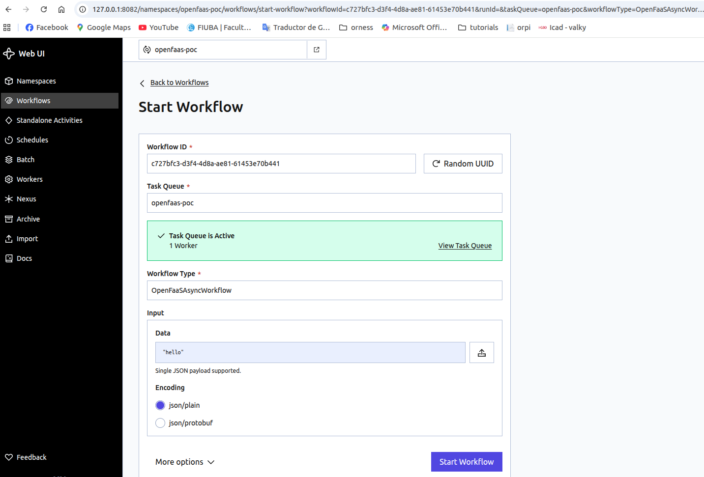
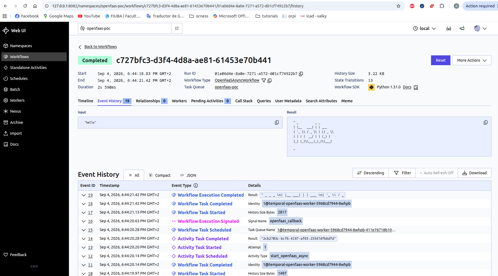

# Deploy your open-source FaaS and Orchestrator

Here is a simple example to deploy [Open-FaaS](https://www.openfaas.com/) an open-source FaaS solution. With this solution, you can build and deploy your own functions and run them in your K8S cluster. You can invoke them using the faas-cli or its API. You can also access its UI to see all your functions and invoke them using the browser. 

I recommend following the Linux Foundation [Introduction to Serverless on Kubernetes](https://training.linuxfoundation.org/training/introduction-to-serverless-on-kubernetes-lfs157/) which explains in more detail the open-faas solution and how to use it. 


Open-FaaS allows you to run your functions in a serverless solution. But what happens if you want to create your own pipeline that executes mutiple functions in a specific order, with retries, etc. Open-FaaS provides some simple tools that may allow you to perform some of this actions but it is not as powerfull as a real orchestrator. For this example, I have chosen [Temporal](https://temporal.io/) which allows you to define your workflow that will invoke the different functions. 


## Open-Faas

```bash
# install openfaas
arkade install openfaas

# show the information. It provides several commands that may be useful
arkade info openfaas

# Get the faas-cli
arkade get faas-cli

# If you are running locally you can forward the gateway to your machine
# so you can access its API and UI. By default, open-faas uses port 8080.
# If your port 8080 is available it is better to forward to 8080 instead of 8081
kubectl rollout status -n openfaas deploy/gateway
kubectl port-forward -n openfaas svc/gateway 8081:8080

# Update default url only if you forwarded to 8081
export OPENFAAS_URL=http://127.0.0.1:8081

# For this POC, get the admin password and use it to log in the cli
# If basic auth is enabled, you can now log into your gateway:
PASSWORD=$(kubectl get secret -n openfaas basic-auth -o jsonpath="{.data.basic-auth-password}" | base64 --decode; echo)
echo -n $PASSWORD | faas-cli login --username admin --password-stdin

# now you are able to use the cli
# deploy the already existing function env that returns the
# environment variables of your function
faas-cli store deploy env
faas-cli list
faas-cli describe env

# Invoke the function using the cli
echo  "" | faas-cli invoke env

# execute the function with an http request
curl -X POST http://127.0.0.1:8081/function/env

# You can check what other functions exist in their store
faas-cli store list
```

If you want to use the UI, access the URL http://127.0.0.1:8081 and log in using the `admin` as username and the password

To create your own function, you can use the existing templates such as python3-http. Then you modify the `handle` function in the file `handler.py`. You will then need to build your function and deploy it to a registry

```bash
# define dockerhub prefix
export OPENFAAS_PREFIX=<your_dockerhub_prefix>

# Creating a function with Python3 is as easy as running the following command:
faas-cli new --lang python3-http api

# Create a local container image, and install any other files needed, like those in the requirements.txt file.
faas-cli build

# Transfer the function’s container image from our local Docker library up to the hosted registry.
faas-cli push

# Using the OpenFaaS REST API, create a Deployment inside the Kubernetes cluster and a new Pod to serve traffic.
faas-cli deploy


# All of those commands can be combined with the faas-cli up command for brevity both initially and for updating.
faas-cli up -f stack.yaml
```

You can try to create your own function, deploy them and the run them using the cli, UI or by doing a HTTP request. Check the examples showed in the Linux Foundation class or in the Open-FaaS website.


## Temporal

```bash
# install postgres needed by temporal
# This is a simple example. Please store the password as a secret and use auth.existingSecret and auth.secretKeys.userPasswordKey instead of passing the password
helm repo add bitnami https://charts.bitnami.com/bitnami
helm repo update
helm upgrade --install temporal-postgresql bitnami/postgresql   --namespace temporal   --set auth.username=temporal   --set auth.password=temporal   --set auth.database=temporal   --set primary.persistence.size=5Gi   --wait


# install temporal
# This is a simple example. Please use existingSecret and secretKey
# instead of passing the password
helm repo add temporal https://go.temporal.io/helm-charts
helm repo update
helm upgrade --install temporal temporal/temporal   --namespace temporal   --values temporal-values.yaml   --timeout 15m   --wait


# port forward the Temporal UI to be able to access it from local
kubectl port-forward -n temporal svc/temporal-web 8082:8080

# If you will start the workflow from local you need to also forward this other port
# ex: starting the workflow using start.py or start_async.py
kubectl -n temporal port-forward svc/temporal-frontend 7233:7233
```

For this example, I used two simple functions: go-echo and figlet. So let's deploy them in open-faas:

```bash
# figlet exists in the open-faas store
faas-cli store deploy figlet

# download the project from git and deploy it
git clone ht‌tps://github.com/alexellis/echo-fn
cd echo-fn
faas-cli template store pull golang-http
faas-cli deploy 
```

With the two available functions we can now deploy the workflow and start it. With the default configuration of Temporal, we can execute workflows that execute the functions in sync mode. This means the wrkflow will execute them and wait for its response. This is good for small functions that can respond rapidly. However, it is better to execute the functions in async mode and continue once the function has finished.

Fortunately, Temporal provides the tools to achieve this goal. When we run a function in async mode on Open-FaaS, we can pass a callback URL. The idea would be to deploy a simple API that will receive the callbacks of the functions and then communicate with the Temporal API to notify this event. In the `temporal-openfaas-poc` directory, you will find the `open_faas_callback` directory which contains the code for managing the callbacks and the manifest to deploy it. You can also see the `worker` directory which has the code and deployment for the two workflows. Both execute the same functions: echo -> figlet. But one does it in sync mode and the other in async mode.

```bash
# Build the callback API and deploy it
docker build -t temporal-openfaas-callback:dev open_faas_callback
kubectl apply -f open_faas_callback/callback-deployment.yaml

docker build -t temporal-openfaas-worker:dev worker/
kubectl apply -f worker/worker-deployment.yaml
```

Once deployed, you should be able to run both workflows. You can do it by using one of the scripts `start_async.py` or `start.py`, or by using the UI

```bash
# Sync workflow
python start.py 
Workflow result:
 _   _      _ _          __                     
| | | | ___| | | ___    / _|_ __ ___  _ __ ___  
| |_| |/ _ \ | |/ _ \  | |_| '__/ _ \| '_ ` _ \ 
|  _  |  __/ | | (_) | |  _| | | (_) | | | | | |
|_| |_|\___|_|_|\___/  |_| |_|  \___/|_| |_| |_|
                                                
 _____                                    _   ____  _ 
|_   _|__ _ __ ___  _ __   ___  _ __ __ _| | |___ \| |
  | |/ _ \ '_ ` _ \| '_ \ / _ \| '__/ _` | |   __) | |
  | |  __/ | | | | | |_) | (_) | | | (_| | |  / __/|_|
  |_|\___|_| |_| |_| .__/ \___/|_|  \__,_|_| |_____(_)
                   |_|                                


# Async workflow 
python start_async.py 
Workflow result:
 _   _      _ _          __                     
| | | | ___| | | ___    / _|_ __ ___  _ __ ___  
| |_| |/ _ \ | |/ _ \  | |_| '__/ _ \| '_ ` _ \ 
|  _  |  __/ | | (_) | |  _| | | (_) | | | | | |
|_| |_|\___|_|_|\___/  |_| |_|  \___/|_| |_| |_|
                                                
 _____                                    _                              _ 
|_   _|__ _ __ ___  _ __   ___  _ __ __ _| |   __ _ ___ _   _ _ __   ___| |
  | |/ _ \ '_ ` _ \| '_ \ / _ \| '__/ _` | |  / _` / __| | | | '_ \ / __| |
  | |  __/ | | | | | |_) | (_) | | | (_| | | | (_| \__ \ |_| | | | | (__|_|
  |_|\___|_| |_| |_| .__/ \___/|_|  \__,_|_|  \__,_|___/\__, |_| |_|\___(_)
                   |_|                                  |___/              

             
```



